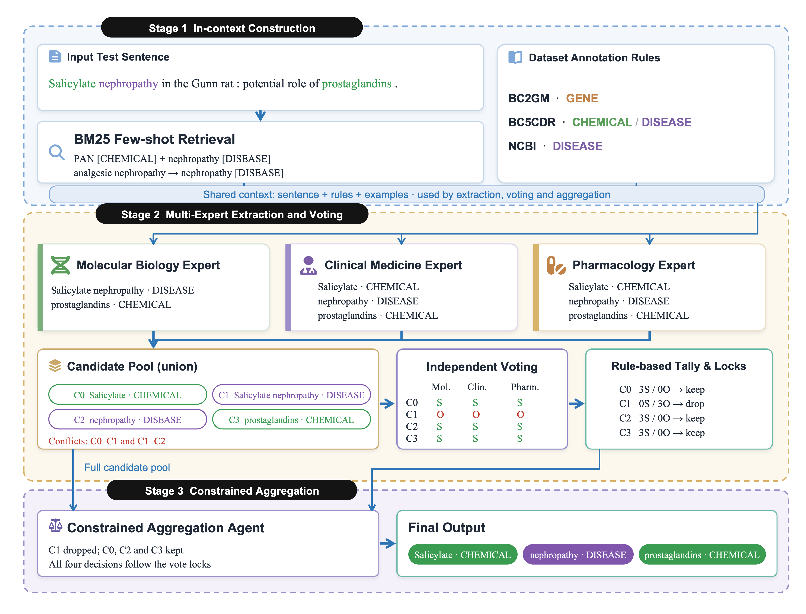

# BioAgent

面向生物医学命名实体识别（Biomedical NER）的多专家 LLM 框架。通过**训练示例检索、多专家独立抽取、候选投票与受约束汇总**，识别原文中的基因、疾病和化学物质，输出实体类型与字符位置。

项目提供普通 LLM baseline、完整专家框架及消融实验，支持 BC2GM、BC5CDR 和 NCBI 三个数据集。

另外提供三种监督微调 baseline，共九组实验：BioBERT / PubMedBERT 共用
`baseline/finetune/bert_ner.py`（BIO token classification），NERLlama3.1 使用
`baseline/finetune/nerllama.py`（Llama-3.1-8B-Instruct + 4-bit QLoRA 指令微调）。
三者共用 `utils.py` 的数据和结果接口，采用完整 train 训练、完整 dev 选择最佳
checkpoint，在相同的 test.sampled_500 上使用现有严格实体级评估器计分。
运行方法见 [baseline/README.md](baseline/README.md)，服务器参数准备见
[baseline/model/README.md](baseline/model/README.md)，训练依赖为 `requirements-finetune.txt`。
`baseline/model/` 除 README 外的参数及 checkpoint 均不进入 Git。

## 🏗️ Architecture



## 🚀 Quick Start

### 1. 📦 Environment

在项目根目录执行。当前本地运行环境为 Python 3.13.13、OpenAI Python SDK 1.104.2；专家实验使用文件锁，建议使用 macOS 或 Linux。

```bash
python3 -m venv .venv
source .venv/bin/activate
python3 -m pip install -r requirements.txt
```

### 2. 🔑 API Keys

按所用配置设置环境变量，将占位内容替换为自己的密钥：

```bash
export OPENAI_API_KEY="your-api-key"
export DEEPSEEK_API_KEY="your-deepseek-api-key"
```

当前 GPT、Grok 配置使用 `OPENAI_API_KEY`，DeepSeek 配置使用 `DEEPSEEK_API_KEY`。模型名称和 API 地址由配置中的 `model_name`、`base_url` 指定，运行前需确认自己的 API 服务支持对应模型。

### 3. 📚 Datasets

| 数据集 | 配置名称 | 数据目录 | 实体类型 |
|---|---|---|---|
| BC2GM | `bc2gm` | `bioDataset/bc2gm1/` | `GENE` |
| BC5CDR | `bc5cdr` | `bioDataset/bc5cdr/` | `CHEMICAL`、`DISEASE` |
| NCBI Disease | `ncbi` | `bioDataset/ncbi/` | `DISEASE` |

每个数据目录需包含 `train.json` 和 `test.sampled_500.json`。当前测试配置读取固定的 500 条测试样本；复现实验应使用相同文件及顺序，不重新随机抽样。训练集用于专家框架的示例检索，baseline 不使用检索示例。

输入为 JSON 列表，格式如下：

```json
[
  {
    "sentence": "Aspirin inhibits COX-2.",
    "entities": [
      {"name": "Aspirin", "type": "CHEMICAL", "pos": [0, 7]}
    ]
  }
]
```

上例采用 BC5CDR 的实体类型。`pos` 为从 0 开始的字符区间 `[start, end)`，右端点不包含在实体内。`entities` 是离线评估所用的真实标注。

### 4. ⚙️ Configuration

配置分别位于 `config/baseline/<dataset>/` 和 `config/expert_agent/<dataset>/`。例如，BC5CDR 的 GPT 专家配置为 `config/expert_agent/bc5cdr/bc5cdr_gpt.json`。

| 参数 | 含义 |
|---|---|
| `dataset` | 数据集标识：`bc2gm`、`bc5cdr` 或 `ncbi` |
| `model_name`、`base_url` | 模型名称与 API 地址 |
| `api_key_env` | 保存密钥的环境变量名称 |
| `test_file_path` | 评估数据路径 |
| `max_loop` | 评估样本数，不是重试次数 |
| `retrieval_k` | 专家框架检索的示例数量 |
| `max_attempts` | 专家阶段重试上限；`null` 表示不设次数上限 |
| `summary_csv` | 结果汇总 CSV 路径 |
| `result_root` | 专家实验详细结果根目录 |
| `save_file_path`、`log_file_path` | baseline 的预测和日志路径 |

### 5. ▶️ Run Experiments

以下以 BC5CDR 的 GPT 配置为例，在项目根目录执行。

**Baseline**

```bash
python3 -u baseline/llm.py --config config/baseline/bc5cdr/bc5cdr_gpt.json
```

**Full**

```bash
python3 -u main.py --config config/expert_agent/bc5cdr/bc5cdr_gpt.json --variant full --limit 500
```

**消融实验**

```bash
python3 -u main.py --config config/expert_agent/bc5cdr/bc5cdr_gpt.json --variant without_retrieval --limit 500
```

切换数据集或模型时替换配置路径，切换消融方法时替换 `--variant`：

| 变体 | 实验设置 |
|---|---|
| `full` | 检索、三专家抽取、投票与受约束汇总 |
| `single_expert` | 一位专业专家直接输出，不投票、不汇总 |
| `without_retrieval` | 移除训练示例，保留标注规则和其他阶段 |
| `without_voting` | 三专家抽取后直接汇总，不使用选票和多数票锁定 |
| `candidate_union` | 直接输出三专家候选并集 |
| `vote_only` | 投票后按规则筛选，不调用汇总 Agent |
| `generic_ensemble` | 将三个专业角色替换为相同的通用标注角色 |

`single_expert` 同时移除了投票和汇总，不应解释为仅改变专家数量的单因素实验。

终端在完成后为每个方案输出一行指标和结果路径；请求、重试及逐阶段记录保存在结果目录的日志中。专家入口添加 `--verbose` 可输出完整 JSON 指标，`--sentence "待识别的句子"` 可直接预测单句。普通 baseline 和 full 运行中断后，可在原命令末尾添加 `--resume`，从已完整保存的样本继续；其他消融变体的主入口不支持该参数。

运行入口统一使用上述命令。临时分片、子分片和指定样本补跑脚本已移除；历史分片结果仍保留，主入口会拒绝向含 `shards/manifest.json` 的旧实验追加记录。需要重新运行时，去掉 `--resume` 即可创建新实验目录。

## 📊 Evaluation & Results

Baseline 和专家框架均采用**实体级 micro Precision、Recall 和 F1**。预测实体的 `(start, end, type)` 必须与标注完全一致；跨有效样本累计 TP、FP、FN 后计算：

```text
Precision = TP / (TP + FP)
Recall    = TP / (TP + FN)
F1        = 2TP / (2TP + FP + FN)
```

无效 JSON、非法类型、无法定位的实体及请求失败不进入 PRF 统计。Baseline 持续重试；专家配置默认不设重试次数上限。若为专家设置有限重试上限，失败样本会被排除并单独记录。**有效空预测参与评分**，其中未识别的标注实体计为 FN。

两种方法采用相同的实体匹配与计分口径，但提示词、输入信息和纠错反馈不完全相同。比较结果时，应同时核对输入数据、有效样本数、配置和运行版本。

测试集结果汇总至：

```text
result/test_500/test_500_summary_prf1.csv
```

详细结果分别保存在 `result/test_500/baseline/` 和 `result/test_500/expert_agent/`。专家实验目录包括：

| 文件 | 内容 |
|---|---|
| `predictions.jsonl` | 逐句预测、标注与阶段记录 |
| `metrics.json` | PRF、有效样本数及运行统计 |
| `run_config.json` | 配置、提示词与数据校验信息 |
| `run.log` | 请求、重试与阶段日志 |

从服务器取回的 `test_500/` 已增量归入 `result/test_500/`。服务器汇总表保存为 `test_500_summary_prf1.server_20261008.csv`，原有总表和历史结果保持原样；源目录仍保留。

Qwen3.5 的 24 条实验汇总保存在 `result/test_500/Qwen3.5_summary_prf1.csv`。原独立归档目录的配置和逐句结果与主目录一致，已清理重复副本。

全部结果统一查看 [全部实验结果汇总.csv](outputs/20261011_results/全部实验结果汇总.csv)，共 192 条记录；F1 在第 2 列，数据划分在第 7 列。覆盖逐次指标文件、历史汇总、服务器结果及未完成的主预测文件；重复归档合并来源，分片不另算实验。表内区分 dev/test、随机种子、评分口径和完成状态；18 条历史记录的数据划分未注明，保留原值。未完成记录不代表完整 500 条实验，缺失的最终指标留空。现有 `result/` 文件保持原样。

## 🧩 Project Structure

专家 Agent 核心共 5 个 Python 文件，每个不超过 200 行。借鉴 KDR-Agent 的职责分工，保留本项目的专家流程、提示词、检索、投票和评分规则；baseline 独立训练程序另行保留。

| 文件 | 职责 |
|---|---|
| `main.py` | 命令行、实验执行、断点校验与恢复 |
| `agent.py` | 专家抽取、投票、冲突约束和汇总 |
| `data.py` | 配置、提示词组装、实体定位和训练集检索 |
| `tool.py` | API 调用、重试、响应校验和评分基础函数 |
| `reporting.py` | 实体评分、诊断指标和结果报表 |

```text
MyBioAgent/
├── main.py                  # 命令行、实验运行与断点恢复
├── agent.py                 # 专家抽取、投票与汇总
├── data.py                  # 配置、提示词组装与检索
├── tool.py                  # API、重试与校验
├── reporting.py             # 评分与报表
├── requirements.txt         # Python 依赖
├── requirements-finetune.txt # 监督微调依赖
├── figure/structure.png     # 框架架构图
├── baseline/
│   ├── llm.py               # 普通 LLM baseline
│   └── finetune/            # BioBERT、PubMedBERT、NERLlama 微调
├── expert_agent/
│   └── prompts/             # 专家阶段提示词及角色描述
├── prompts/
│   ├── shared.txt           # 共享任务约定
│   └── annotation_rules/    # 数据集标注规则
├── config/
│   ├── baseline/            # baseline 配置
│   └── expert_agent/        # 专家实验配置
├── bioDataset/              # 训练集与固定测试样本
├── result/                  # 实验结果与汇总
├── tests/                   # 核心功能回归测试
└── README.md
```

核心回归测试不调用外部 LLM API，覆盖请求与结果回放、全部消融变体、断点续跑、实体评分、结果汇总及微调流程：

```bash
python3 -m unittest discover -s tests -v
```

运行微调流程测试需要安装 `requirements-finetune.txt` 中的依赖。
